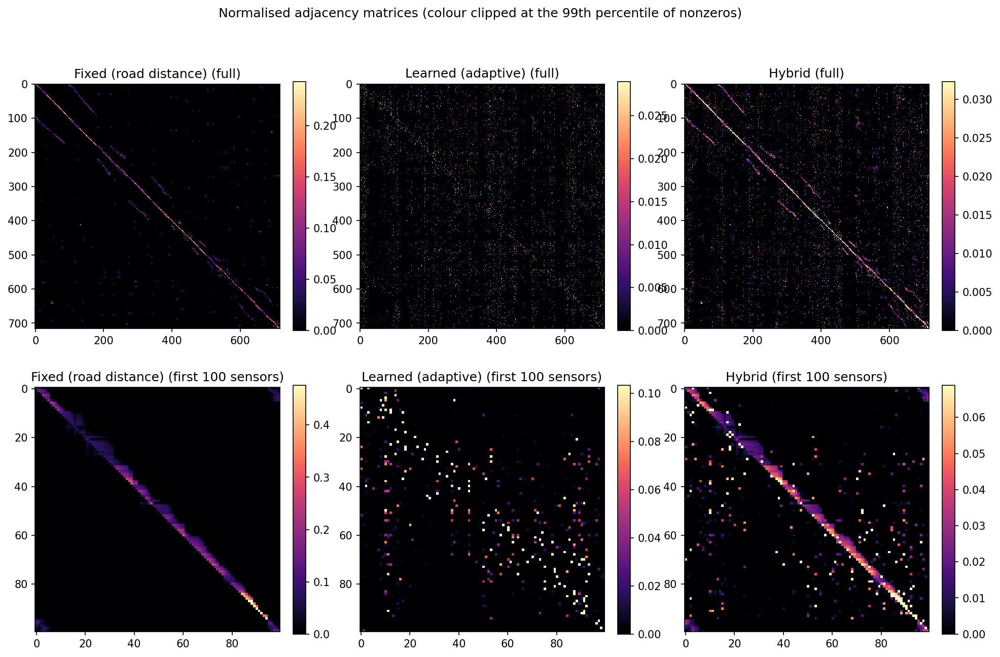
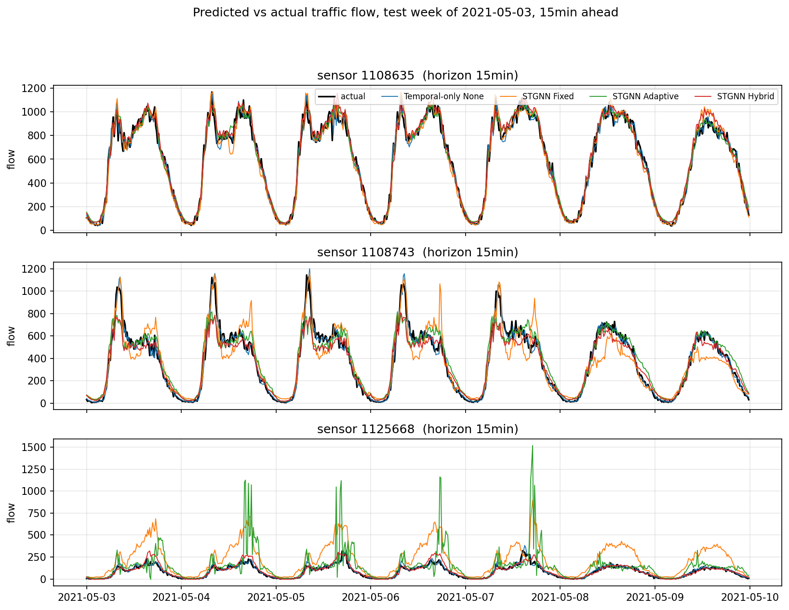
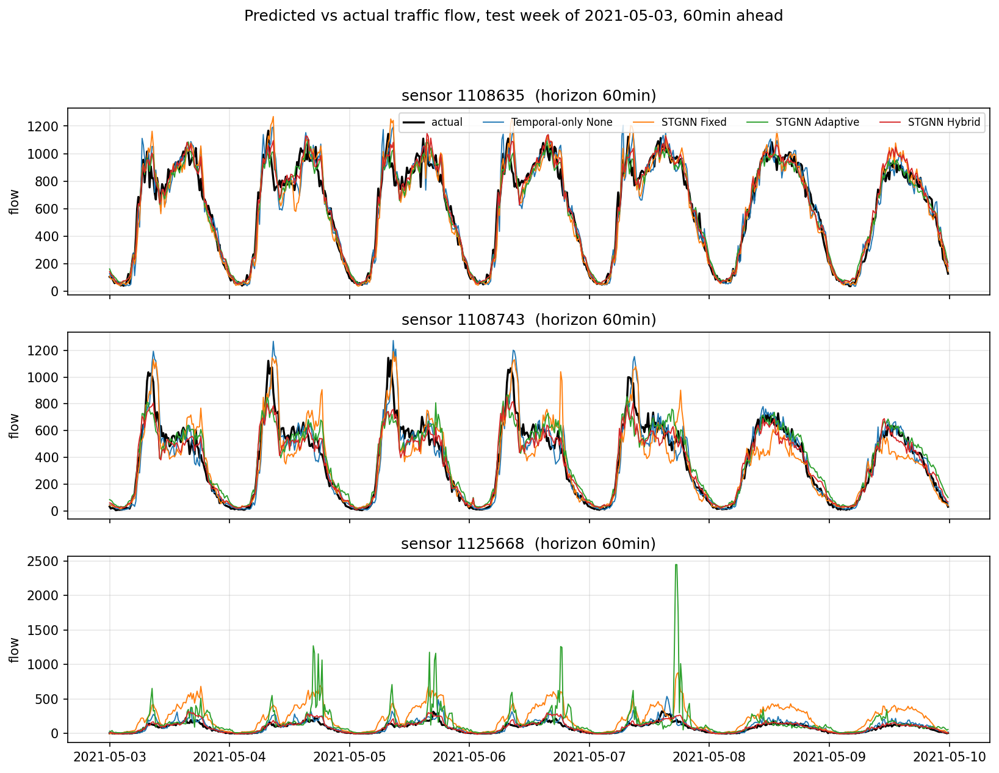

# AI651 — Programming Assignment 3

**Deep Learning for Space, Time and Graphs | Fall 2026**  
**Lahore University of Management Sciences (LUMS)**  
**Author:** Mubeen Ahmed · **Student ID:** 25280101

## Overview

This repository documents Programming Assignment 3 for AI651. It examines how graph-message aggregation affects expressivity, why direction matters in a moving traffic pattern, and whether graph structure improves spatio-temporal forecasting on the **LargeST San Diego (SD)** subset.

The assignment is organised into seven questions:

| Question | Topic | Main implementation / output |
|---|---|---|
| Q1 | Sum, mean and max aggregation | Analytical examples and exhaustive verification of count encoding |
| Q2 | Direction of slowdown on a 40-sensor ring | Least-squares fitting, exact directed/history rules and rollout heatmaps |
| Q3 | LargeST-SD data preparation and road graph | Resampling, missingness, adjacency and neighbourhood visualisations |
| Q4 | Spatio-temporal graph forecasting | Temporal-only baseline and fixed-adjacency STGNN |
| Q5 | Fixed, adaptive and hybrid adjacency | Trainable node embeddings, learned/hybrid graphs and comparisons |
| Q6 | Forecast and graph interpretation | Final metrics, predicted-versus-actual plots and graph analysis |
| Q7 | Reproducibility | Configuration, runtime environment, measurements and reporting |

## Repository structure

```text
AI651-PA3/
├── README.md
├── .gitignore
├── src/                            # Add original files from pa3_code.zip
│   ├── common.py
│   ├── data_utils.py
│   ├── largest_io.py
│   ├── models.py
│   ├── q1_aggregation.py
│   ├── q2_direction.py
│   ├── q3_dataset.py
│   ├── q4_stgnn.py
│   ├── q5_adjacency.py
│   ├── q6_analysis.py
│   ├── q7_report.py
│   └── requirements.txt
├── notebooks/
│   └── PA3_runner.ipynb
├── outputs/
│   ├── figures/                    # Saved experimental plots (PNG/PDF)
│   ├── results/                    # Metrics, CSV, JSON, arrays and predictions
│   └── checkpoints/                # Generated during training; not tracked by Git
├── report/
│   ├── main.tex
│   ├── main.pdf
│   ├── tables/
│   └── figures/                    # Figures referenced by main.tex
└── data/                           # Raw and processed LargeST files; not tracked by Git
```

**Important:** The supplied files for this repository starter contain the executed notebook and saved experimental outputs, **but not the original `pa3_code.zip`**. Copy the listed `.py` scripts and `requirements.txt` into `src/` from your original experiment-code archive before claiming that the repository is fully reproducible. The directory tree above shows the *intended final layout*, not proof that the source files have already been included.

## Dataset and forecasting task

- **Dataset:** [LargeST](https://github.com/liuxu77/LargeST), San Diego subset (District 11), **716 traffic sensors**.
- **Raw data:** 2020 and 2021, sampled at **5-minute intervals**.
- **Resampling used:** sum each three consecutive 5-minute vehicle-count readings to obtain a **15-minute count**, in **vehicles per 15 minutes**.
- **Forecasting windows:** 8 observed intervals (2 hours) to predict the next 4 intervals (1 hour), for all 716 sensors.
- **Chronological split:** 2020 training; January–March 2021 validation; April–December 2021 testing.
- **Normalization:** training-period statistics only; no forecasting window crosses a split boundary.
- **Missing data:** causal forward filling of inputs, training-period mean for leading gaps, and missing-target masks in the objective/evaluation. Some sensors are entirely missing; the precise fallback implementation should be verified against the original source code.

**Data access:** [Kaggle — LargeST dataset](https://www.kaggle.com/datasets/liuxu77/largest). Raw and processed datasets are not committed to this repository. The runner expects the LargeST California metadata/adjacency and 2020–2021 raw traffic files. Kaggle credentials (`kaggle.json`) must **never** be committed.

## Quick start: Google Colab (recommended)

The provided **`notebooks/PA3_runner.ipynb`** is the actual experiment runner used for the saved outputs. Its cells mount Google Drive, upload `pa3_code.zip`, configure training, and run Q1–Q7 in sequence.

1. Put the original scripts and `requirements.txt` in `src/`. Create the archive expected by the notebook:

   ```bash
   cd src
   zip -r ../pa3_code.zip . -x '__pycache__/*'
   cd ..
   ```

   Upload `pa3_code.zip` when prompted by the notebook. **Do not commit** this generated archive to Git; the scripts should already be version-controlled in `src/`.

2. Open `notebooks/PA3_runner.ipynb` in Google Colab and select a **T4 GPU** runtime (or another available GPU).
3. Run cells **from top to bottom**. Grant Google Drive access and upload `pa3_code.zip` in cell 2.
4. If the processed SD dataset is not already cached, supply Kaggle API credentials (`kaggle.json`) when prompted. The notebook caches the processed data on Drive.
5. Run Q1–Q7 and use the final cell to export figures and results.

The notebook's default Drive folders are:

```text
/content/drive/MyDrive/AI651_PA3/
├── data/               # Cached, preprocessed dataset
├── outputs/
│   ├── figures/
│   ├── results/
│   └── ...              # Training checkpoints
└── pa3_code.zip         # Uploaded source archive copy
```

Saved experiment outputs were generated with `STRIDE=1` on a GPU. The notebook uses `STRIDE=2` on CPU by default, so CPU runs need not have exactly the same training sample count.

## Local execution (after adding the original source code)

Recommended environment: Linux, Python and the dependencies listed in the **original** `src/requirements.txt`. The recorded Colab environment used Python **3.13.16** and PyTorch **2.14.1+cu130**. Other versions may work but have not been verified here.

```bash
# From the repository root:
python -m venv .venv
source .venv/bin/activate
pip install -r src/requirements.txt

export PA3_DATA_DIR="$(pwd)/data"
export PA3_RAW_DIR="$(pwd)/data/raw"
export PA3_OUT_DIR="$(pwd)/outputs"
mkdir -p "$PA3_DATA_DIR" "$PA3_RAW_DIR" "$PA3_OUT_DIR"

cd src
python q1_aggregation.py
python q2_direction.py
python q3_dataset.py --agg sum

python q4_stgnn.py --epochs 30 --hidden 32 --batch_size 64 --lr 0.001 --emb_dim 10 --topk 0 --seed 42 --train_stride 1
python q5_adjacency.py --epochs 30 --hidden 32 --batch_size 64 --lr 0.001 --emb_dim 10 --topk 0 --seed 42 --train_stride 1
python q6_analysis.py --k 10
python q7_report.py
```

**Before Q3:** obtain the raw LargeST files through Kaggle and make them available to the data-loading code, or use the Colab runner's download/caching workflow. The commands above reflect the arguments actually used in the notebook; they have **not** been re-executed against the missing `.py` source archive. On a CPU, consider `--train_stride 2` to reduce training cost, but note that this changes the training protocol.

**Resume/restart:** The original notebook describes resumable training; to retrain an already completed model, it recommends adding `--force` to the relevant command or removing that model's metrics/checkpoint files. Confirm the supported flags and paths in your original scripts before doing so.

## Training configuration

| Setting | Value |
|---|---|
| Random seed | **42** |
| Optimizer | Adam |
| Learning rate | 0.001 |
| Weight decay | 0 |
| Loss | Masked MAE |
| Maximum epochs | 30 |
| Early-stopping patience | 6 |
| Batch size | 64 |
| Temporal/spatial hidden dimension | 32 |
| Adaptive node embedding dimension | 10 |
| Adaptive graph top-k | 0 (dense) |
| Training window stride on GPU | 1 |
| Gradient clipping | 5.0 |
| Input/output length | 8 / 4 |
| Adjacency mixing | Learned scalar for hybrid model |

The temporal encoder uses two 1D convolutions and a projection. The graph-based models apply spatial graph convolution to per-sensor temporal features, followed by a four-step forecast head. The fixed graph uses directed row normalization because the San Diego road adjacency is not symmetric.

## Recorded results

**Test period: April–December 2021.** MAE and RMSE are reported in the original units of **vehicles per 15 minutes**. Times reflect the recorded GPU run (not guaranteed for different hardware).

| Model | Adjacency | Test MAE | Test RMSE | Training time |
|---|---|---:|---:|---:|
| Temporal-only | None | **64.552** | **101.312** | 8.15 min |
| STGNN | Fixed road graph | 140.232 | 218.190 | 8.60 min |
| STGNN | Adaptive | 82.169 | 129.802 | 8.85 min |
| STGNN | Hybrid | 79.310 | 125.542 | 8.87 min |

The **temporal-only baseline was the best-performing model overall**; the **hybrid graph was the best among graph-based variants**. The learned hybrid mixing coefficient was approximately **0.258**, meaning the trained graph placed greater weight on the adaptive component under the implemented mixing convention.

### Selected visualisations

**Adjacency structures**



**Forecasts versus observations, 15-minute horizon**



**Forecasts versus observations, 60-minute horizon**



Further plots and machine-readable results are in `outputs/figures/` and `outputs/results/`. For exact values and the software environment, see `outputs/results/reproducibility.md` and `outputs/results/hardware.json`.

## Rebuilding the report in TeXstudio

The LaTeX project lives in `report/`. Open **`report/main.tex`** in TeXstudio and compile using **PdfLaTeX twice**. The source expects the `report/figures/` and `report/tables/` directories to remain beside `main.tex`.

On a command line:

```bash
cd report
pdflatex -interaction=nonstopmode -halt-on-error main.tex
pdflatex -interaction=nonstopmode -halt-on-error main.tex
```

**Submission checklist:** Replace the public GitHub URL placeholder in `report/main.tex`, complete the factual AI-use disclosure (including any edits made after drafting), recompile, and ensure the repository is public when submitting. The report PDF should be the single PDF submitted to the course LMS, as required in the handout.

## Reproducibility notes and limitations

- Original training hardware: NVIDIA **Tesla T4** (15.6 GB GPU memory), Intel Xeon CPU, approximately 13.6 GB RAM.
- Experiments use a single recorded random seed (**42**), rather than multi-seed uncertainty estimates.
- The original source code was not provided with the results archive. This starter cannot validate the implementation of entirely missing sensors or independently reproduce training until `src/` is populated.
- In the saved graph analysis, some sensor-correlation summaries are `NaN`. Avoid interpreting those as measured correlations until valid sensor pairs are recomputed.
- Lower forecasting error does not, by itself, imply that learned adjacency corresponds to actual physical roads or causal links.
- Code and report should be reviewed against the course's reproducibility and AI-use disclosure requirements before submission.

## Acknowledgements and sources

- LargeST project: https://github.com/liuxu77/LargeST
- LargeST data: https://www.kaggle.com/datasets/liuxu77/largest
- AI651 course assignment handout (Fall 2026).
